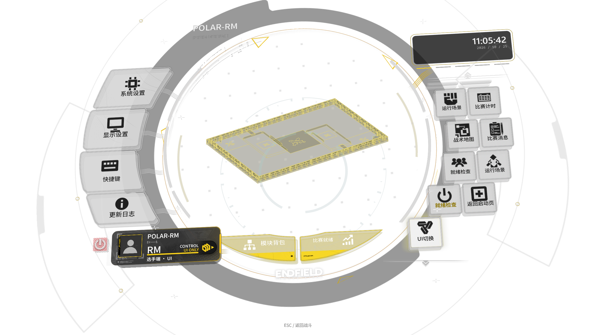

# 功能封装与 UI切换占位项验收

2026-10-25 在当前 Windows 工作区完成。实际窗口和原生渲染检查均使用客户端自有实例及无控制输出的测试传输；运行游戏不是本轮验收步骤。

| 证据 | 结果与范围 |
| --- | --- |
| [migration-map.json](migration-map.json) | 代码、工具、测试、文档及资源的旧路径到新路径映射 |
| [resource-before.json](resource-before.json)、[delivery.json](delivery.json) | 306 个原有资源哈希不变；顶层菜单清单和 CURRENT 更新；当前 311 个资源均未被 Git 忽略；便携版目录复制前后资源树哈希一致 |
| [native-build.json](native-build.json) | 当前 DLL、固定上游版本、适配源码摘要及派生编译单元记录 |
| [regression.json](regression.json) | 21 组回归、272 个 unittest 用例全部通过；验证前后声明源码指纹一致 |
| [quality.json](quality.json) | 260 个 Python 模块、3812 个函数，静态质量检查通过，无初始化依赖环；此处保存完整质量报告的摘要 |
| [placeholder.json](placeholder.json) | 1280×720 中文、1920×1080 英文实际 D3D：悬停命中新条目；各点击两次均保持菜单打开，动作值为 0 |
| [desktop.json](desktop.json) | 默认随附资源的完整 Qt/OpenGL/D3D 集成、5 次菜单周期、全屏与既有动作；真实 Qt 点击占位项不关闭菜单、不派发客户端动作 |
| [inertia.json](inertia.json) | 新构建的惯性衰减、重新按住、停稳松手、暂停、边界、关闭重开六项检查通过 |
| [wiki-desktop.json](wiki-desktop.json) | 迁移后 Wiki 六分类、74 个模块、473 项设置，以及搜索、动画、拖动、返回、全屏和 Esc 接续检查通过 |

截图来自客户端原生渲染层读回；透明位置呈黑色，完整窗口背景合成另由桌面报告检查。报告中的绝对路径属于本次取证工作区，不是运行所需路径。临时完整日志与编译依赖保留在被忽略的 `tmp/endfield/20261025-encapsulation/` 及 `tmp/endfield/dependencies/`。

本轮没有构建完整发布 EXE，也没有执行 Git 暂存、提交或 push。资源发布布局、源码回归和 Windows 原生显示已经分别验证；这些结果不代表实车或比赛资格验证。
